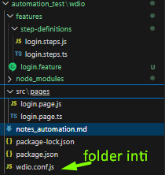

run
    pastikan di folder (cd wdio) dan kalau file ts harus diubah dahulu ke format js
    

1. npx wdio run wdio.conf.js --spec ./features/login.feature

2.kalau ada memasukkan pin, untuk perintah runnya seperti ini
    $env:MPAJAK_PIN = '123456'
    npx wdio run wdio.conf.js --spec ./features/login.feature

    perintah copilot dengan terminal "powerShell"
    Set-Location 'C:\Users\Yudi Mulyadi\OneDrive\Documents\Mpajak Project\automation_test\wdio'; $env:MPAJAK_PIN = '123456'; npx wdio run wdio.conf.js --spec ./features/login.feature

3. perintah dengan terminal "gitbash"
cd "/c/Users/Yudi Mulyadi/OneDrive/Documents/Mpajak Project/automation_test/wdio"
$ MPAJAK_PIN=123456 npx wdio run wdio.conf.js --spec ./features/login.feature

Untuk mengecek bahwa environment variable tersedia tanpa menampilkan PIN-nya:
$ if [[ -n "${MPAJAK_PIN:-}" ]]; then echo "MPAJAK_PIN tersedia"; else echo "MPAJAK_PIN belum tersedia"; fi

4. perintah tanpa menjalankan negatif dan smoke tes
cd Yudi Mulyadi@Workpro-Lite MINGW64 ~/OneDrive/Documents/Mpajak Project/automation_test/wdi (main)
                V note (pastikan server appium dijalankan)
$ MPAJAK_PIN=123456 npx wdio run wdio.conf.js --spec ./features/login.feature --cucumberOpts.tagExpression '@login-success'

5. menjalankan 1 file feature
    $ npx wdio run ./wdio.conf.js
            hanya file feature login
    $ npx wdio run ./wdio.conf.js --spec ./features/login.feature
            Jika terminal berada di folder utama proyek, gunakan path relatif dari sana:
    $ npx wdio run ./automation_test/wdio/wdio.conf.js
            menjalankan dengan Input Pin otomatis
    $ MPAJAK_PIN='123456' npx wdio run ./wdio.conf.js --spec ./features/login.feature --cucumberOpts.tagExpression '@login-success'

6. Perintah menjalankan file feature kedua (layanan.feature)
$ MPAJAK_USER_ID='1322111111111111' MPAJAK_PASSWORD='abcdef123456' MPAJAK_PIN='123456' npx wdio run ./wdio.conf.js --spec ./features/menuLayanan.feature --cucumberOpts.tagExpression '@NavMenu-Layanan'

7. masih error
npx wdio run ./wdio.conf.js --spec ./features/menuLayanan.feature

*****************************************************************************************************************